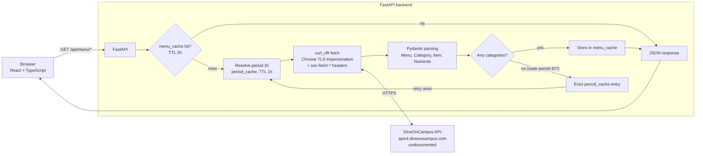
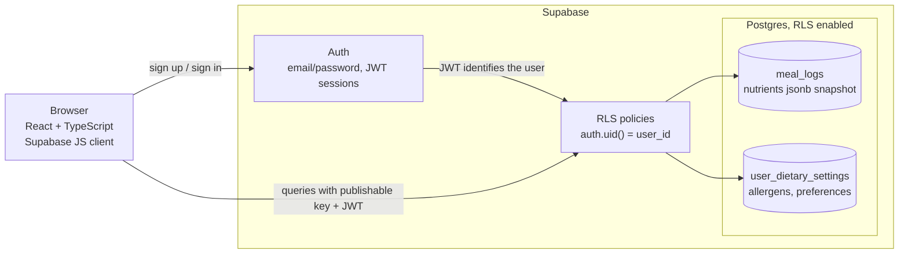
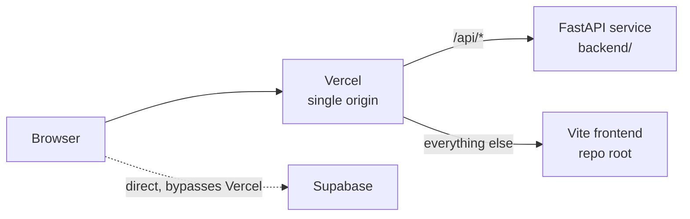

# DineNEU

DineNEU is a web app for Northeastern University students to browse live dining hall menus, log what they eat, and track nutrition over time. Campus dining menus are published through DineOnCampus with no way to filter by allergen or total up what you ate, or have a personalized view of your nutrition so DineNEU adds all three. It covers Stetson East, International Village, and 60 Belvidere dining halls.

## Tech stack

| Layer | Technology |
|---|---|
| Frontend | React 19, TypeScript 6, Vite 8, React Router 7, Tailwind CSS 4, Recharts 3, lucide-react |
| Backend | Python 3.14, FastAPI, Pydantic 2, `curl_cffi`, `cachetools` |
| Database / Auth | Supabase (Postgres, Row Level Security, email/password auth) |
| Testing | Vitest + jsdom (API client tests) |
| Deployment | Vercel (frontend and backend as one project) |

## Key features

- **Menu browsing:** live menus for three dining halls, by meal period (breakfast, lunch, dinner), grouped by station, with search.
- **Dietary filters:** exclude allergens and require dietary preferences (e.g. Vegan, Vegetarian).
- **Allergen normalization:** upstream allergen labels vary (`Milk*`, `Milk (Sheep Milk)`). They are collapsed to a single canonical name so filters behave predictably.
- **Nutrition logging:** select items, set servings, and log them to your account.
- **Dashboard:** daily, weekly and monthly totals for calories, protein, sodium, fat and more, with a nutrient breakdown chart and a list of logged items you can delete.
- **Persisted settings:** save allergens and dietary preferences once. They are stored per user and applied automatically on the menu page.
- **Auth:** email/password sign-up and sign-in; the dashboard and settings require an account.

## Architecture

The system is easiest to read as two separate flows: the menu data pipeline (browser to backend to DineOnCampus) and the auth and data side (browser directly to Supabase).

### Menu data pipeline



Without the browser-like headers, the upstream API returns degraded data (a reduced, coffee-only menu), which is why requests go through `curl_cffi` rather than a plain HTTP client. An empty result is returned as-is after the single retry and is not cached.

### Auth and data



### Deployment topology



**Two services.** The React frontend and the FastAPI backend are separate services. The frontend calls the backend at `VITE_API_URL` for menu data (`/api/menu`, `/api/menu/periods`, `/api/menu/locations`). It talks to Supabase directly with the public client for everything user-specific.

**Menu pipeline.** The backend fetches from DineOnCampus's undocumented public API, the same one its own website uses. It uses `curl_cffi` to send browser-like requests (Chrome TLS impersonation plus a few `sec-fetch-*` headers), because the API returns a reduced, coffee-only menu to plain HTTP clients. Responses are parsed into typed Pydantic models, with nutrients normalized to consistent fields and `null` when a value is missing. They are cached in-memory with `cachetools` (periods for 1 hour, menus for 2 hours). Because the API is undocumented, it can change without notice.

**Auth and data.** Supabase handles authentication. The browser talks to Postgres directly through the publishable key, and Row Level Security policies restrict every row to its owner (`auth.uid() = user_id`). The backend holds no user data and needs no Supabase credentials.

## Design decisions

**jsonb nutrient snapshots.** Each `meal_logs` row stores the item's nutrients as they were at log time, rather than referencing a menu item. Menu items change or disappear from day to day, so a snapshot keeps past logs and dashboard totals accurate.

**RLS as the security boundary.** The browser queries Postgres directly, and policies restrict every row to its owner with `auth.uid() = user_id`. Because the backend holds no user data and has no Supabase credentials, there is no backend middleware that would need to enforce access.

**`null` means unknown, not zero.** In the `Nutrients` model, a value the upstream API does not provide is `null`, not `0`. Treating it as zero would silently under-count in the dashboard totals and imply an item has none of a nutrient when the data is simply missing.

**Stale-period-ID recovery.** Period IDs are cached for an hour, but upstream can change them, in which case a menu request comes back empty. When that happens the backend evicts the cached periods for that location, re-resolves the IDs and retries once, so a stale ID does not leave the menu empty until the cache expires.

## Getting started

**Prerequisites:** Node 20+ and Python 3.11+ (developed on Node 24 and Python 3.14), plus a Supabase project.

**1. Frontend**

```bash
npm install
```

Create `.env` in the repo root:

```
VITE_API_URL=http://localhost:8000/api
VITE_SUPABASE_URL=https://<your-project-ref>.supabase.co
VITE_SUPABASE_PUBLISHABLE_KEY=<your-supabase-publishable-key>
```

```bash
npm run dev          # http://localhost:5173
```

**2. Backend**

```bash
cd backend
python -m venv venv
source venv/bin/activate
pip install -r requirements.txt
uvicorn main:app --reload --port 8000
```

The backend reads one optional environment variable, `FRONTEND_URL`, which sets the allowed CORS origin. It defaults to `http://localhost:5173`, so no configuration is needed locally. It does not load `.env` files automatically, so export it in your shell if you need it.

**3. Database:** apply the migrations (see [Database](#database)).

Other scripts: `npm test` (Vitest), `npm run lint`, `npm run build`.

## Deployment

Deployed on Vercel as a single project. `vercel.json` defines two services: the Vite frontend at the repo root, and the FastAPI backend in `backend/` (entrypoint `main:app`). Rewrites send `/api/*` to the backend and everything else to the frontend, so both are served from one origin. The Supabase URL and key are set as project environment variables in Vercel.

## Database

Schema lives in `supabase/migrations/`:

| Migration | Table | Purpose |
|---|---|---|
| `20260826000000_create_meal_logs.sql` | `meal_logs` | One row per logged item: hall, period, quantity, and a `jsonb` snapshot of the nutrients at log time |
| `20260929000000_create_user_dietary_settings.sql` | `user_dietary_settings` | One row per user: saved allergens and dietary preferences |

Both tables reference `auth.users` with `on delete cascade` and have RLS enabled. `meal_logs` allows users to select, insert and delete their own rows. `user_dietary_settings` allows select, insert and update.

To apply them, open your Supabase project's **SQL Editor** and run each file in filename order.
